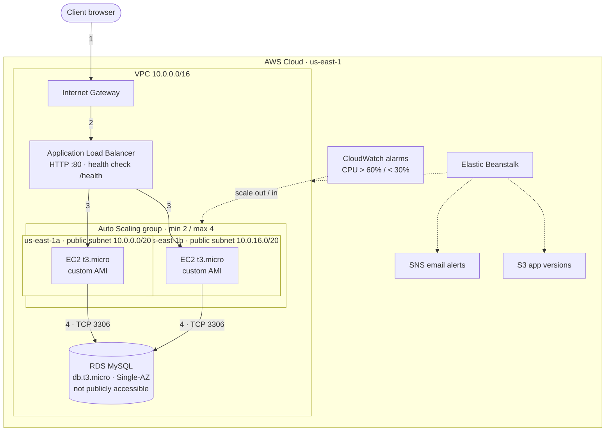

# FreshBasket — Highly Available Flask App on AWS Elastic Beanstalk

A load-balanced, auto-scaling Python web application deployed on AWS across two Availability Zones, backed by Amazon RDS for MySQL. Infrastructure was built from a custom VPC and a custom AMI, and the environment was provisioned with the AWS CLI.


<!-- 📸 SCREENSHOT: hero image of the running app (docs/screenshots/app-home.png) -->


---

## Table of contents

- [The problem](#the-problem)
- [Architecture](#architecture)
- [What I built](#what-i-built)
- [How it scales and recovers](#how-it-scales-and-recovers)
- [The application](#the-application)
- [Deploying it yourself](#deploying-it-yourself)
- [Running locally](#running-locally)
- [Problems I hit and how I fixed them](#problems-i-hit-and-how-i-fixed-them)
- [What I'd change for production](#what-id-change-for-production)
- [Repository layout](#repository-layout)
- [Acknowledgements](#acknowledgements)

---

## The problem

FreshBasket is a fictional Sydney marketplace connecting local growers with home cooks. It served around 200 daily users from **a single desktop PC**, and a morning-TV feature was about to send an unpredictable traffic spike its way.

That setup had two problems:

| Problem                     | Risk                                                                       |
| --------------------------- | -------------------------------------------------------------------------- |
| **Fixed capacity**          | One machine either wastes money or falls over under load                   |
| **Single point of failure** | A power cut, hardware fault or ISP outage takes the whole business offline |

The goal was to move it to AWS with an architecture that **scales automatically** and **survives the loss of a server or a whole data centre**.

---

## Architecture

<!-- 📸 SCREENSHOT: your final draw.io diagram (docs/screenshots/architecture.png) -->


<details>
<summary>Text version of the architecture (renders on GitHub)</summary>



</details>

**Request flow**

1. A customer's browser sends an HTTP request to the environment URL, which enters the VPC through the **Internet Gateway**.
2. The **Application Load Balancer** receives it.
3. The ALB forwards it to a **healthy EC2 instance** in either Availability Zone.
4. The instance reads or writes **RDS MySQL** over port 3306.
5. The response travels back the same way: EC2 → ALB → client.

---

## What I built

| Layer              | Configuration                                                                                                                                              |
| ------------------ | ---------------------------------------------------------------------------------------------------------------------------------------------------------- |
| **Network**        | Custom VPC `10.0.0.0/16` with two public subnets (`10.0.0.0/20` in us-east-1a, `10.0.16.0/20` in us-east-1b), an Internet Gateway and a public route table |
| **Compute**        | EC2 `t3.micro` instances launched from a **custom AMI** built on the Elastic Beanstalk Python 3.12 / Amazon Linux 2023 platform image. IMDSv2 only         |
| **Load balancing** | Internet-facing Application Load Balancer across both AZs, health check on `/health`                                                                       |
| **Auto scaling**   | Min **2**, max **4** instances. Scale out +1 when average CPU > **60 %**, scale in −1 when < **30 %** (5-minute evaluation)                                |
| **Database**       | Amazon RDS for MySQL, `db.t3.micro`, 20 GB, Single-AZ, **not publicly accessible**, automated backups enabled                                              |
| **Security**       | Custom EC2 security group (HTTP 80 open, SSH 22 restricted to one admin IP), custom key pair, DB security group allowing MySQL only from the app instances |
| **Operations**     | SNS email notifications for environment events, enhanced health reporting, application versions stored in S3                                               |
| **Provisioning**   | Elastic Beanstalk environment created with the **AWS CLI** from a single JSON option-settings file                                                         |

<!-- 📸 SCREENSHOTS: infrastructure evidence. Keep the ones you think are most impressive. -->

<details>
<summary>📸 Infrastructure screenshots</summary>

**VPC with two public subnets in separate AZs**


**Custom AMI**


**Elastic Beanstalk environment (Health OK)**


**Auto Scaling configuration**


**Two instances running in different AZs**


**RDS MySQL: Single-AZ, not publicly accessible**


**Security group rules**


**SNS notification email**


</details>

---

## How it scales and recovers

### Scaling

- **CloudWatch** tracks average CPU across the Auto Scaling group.
- Above **60 %** for 5 minutes adds an instance (up to 4); below **30 %** removes one (down to 2). The gap between the thresholds stops the group from flapping.
- The **ALB** registers new instances automatically, so extra capacity starts taking traffic without any manual change.
- All state lives in **RDS**, so the app servers are **stateless**: any instance can answer any request, which is what makes horizontal scaling work.

### Fault tolerance

| Failure                             | What happens                                                                                                                        |
| ----------------------------------- | ----------------------------------------------------------------------------------------------------------------------------------- |
| One EC2 instance fails              | The ALB health check stops sending it traffic; the other instance keeps serving; the ASG launches a replacement from the custom AMI |
| A whole Availability Zone goes down | The instance in the other AZ keeps the site up                                                                                      |
| A bad deployment                    | Roll back to a previous application version stored in S3                                                                            |
| Data loss or corruption             | Point-in-time restore from RDS automated backups                                                                                    |

**Known limitation:** the database is **Single-AZ** by design for this prototype, so it's the remaining single point of failure. The fix is in [What I'd change for production](#what-id-change-for-production).

---

## The application

A small Flask marketplace where growers list produce and everyone sees the live listings.

- **Write path:** the form inserts a listing into RDS.
- **Read path:** the page lists every listing from RDS.
- **Load-balancing proof:** each page shows the **EC2 instance ID and Availability Zone** that served it, read from instance metadata (IMDSv2). Refreshing switches between instances while the data stays the same.

<!-- 📸 SCREENSHOT: the success message after adding a listing (docs/screenshots/app-write.png) -->


<!-- 📸 SCREENSHOT: same page after a refresh, different instance ID (docs/screenshots/app-load-balancing.png) -->


### Endpoints

| Route            | Purpose                                                                                                                                 |
| ---------------- | --------------------------------------------------------------------------------------------------------------------------------------- |
| `GET /`          | Listings page with the request-path panel                                                                                               |
| `POST /listings` | Validates and saves a listing, then redirects (Post/Redirect/Get)                                                                       |
| `GET /health`    | Load balancer health check. Deliberately **doesn't** touch the database, so a brief RDS blip doesn't make every instance look unhealthy |
| `GET /db-check`  | JSON proof that this instance can reach and read RDS                                                                                    |

### Design details worth noting

- **Zero hard-coded credentials.** DB settings come from the `RDS_*` environment variables that Elastic Beanstalk injects when the database belongs to the environment.
- **Safe concurrent startup.** Several instances boot at once behind the ASG, so table creation and seeding run under a MySQL named lock (`GET_LOCK`) to stop duplicate seed rows.
- **Parameterised SQL** throughout, server-side input validation, and Jinja auto-escaping for user-supplied text.
- **Graceful failure.** If RDS is unreachable the page returns HTTP 503 with a clear error instead of crashing.
- Served by **Gunicorn** behind the platform's nginx.

---

## Deploying it yourself

> Tested in an AWS Academy Learner Lab (us-east-1), which requires the pre-built `LabRole` and `LabInstanceProfile`. On a normal account, use your own Beanstalk service role and EC2 instance profile.

### Prerequisites

- An AWS account and the AWS CLI (CloudShell works).
- In the target region: a VPC with **two public subnets in different AZs** (auto-assign public IPv4 enabled), an EC2 security group allowing HTTP 80 (and SSH 22 if needed), and an EC2 key pair.

### 1. Find the Beanstalk platform AMI

```bash
aws elasticbeanstalk list-platform-versions --region us-east-1 \
  --filters '[{"Type":"PlatformLifecycleState","Operator":"=","Values":["Recommended"]}]' \
  --query "PlatformSummaryList[?contains(PlatformArn,'Python') && contains(PlatformArn,'2023')].PlatformArn" \
  --output text

aws elasticbeanstalk describe-platform-version --region us-east-1 \
  --platform-arn "arn:aws:elasticbeanstalk:us-east-1::platform/Python 3.12 running on 64bit Amazon Linux 2023/<version>" \
  --query "PlatformDescription.CustomAmiList" --output table
```

Use the `hvm` image ID.

> ⚠️ The custom AMI **must** be built from the Beanstalk platform image for the same branch you deploy. A plain Amazon Linux AMI doesn't have the Beanstalk agent and the environment won't launch.

### 2. Build the custom AMI

Launch a `t3.micro` from that AMI, connect as `ec2-user`, then customise and image it:

```bash
sudo dnf update -y
sudo dnf install -y mariadb105 htop
echo "FreshBasket base image - built $(date -u +%F)" | sudo tee /etc/freshbasket-ami
```

**EC2 → Instance → Actions → Image and templates → Create image**. Once it's _Available_, terminate the builder instance.

### 3. Upload the application version

Zip the **contents** of the repo (files at the root of the zip, including the hidden `.ebextensions` folder):

```bash
zip -r freshbasket-v1.zip application.py requirements.txt Procfile .ebextensions

BUCKET=$(aws elasticbeanstalk create-storage-location --region us-east-1 --query S3Bucket --output text)
aws s3 cp freshbasket-v1.zip s3://$BUCKET/freshbasket/freshbasket-v1.zip
aws elasticbeanstalk create-application --region us-east-1 --application-name freshbasket
aws elasticbeanstalk create-application-version --region us-east-1 --application-name freshbasket \
  --version-label v1 --source-bundle S3Bucket=$BUCKET,S3Key=freshbasket/freshbasket-v1.zip
```

### 4. Fill in the option settings

Set your values, then render [`deploy/options.template.json`](deploy/options.template.json):

```bash
export SERVICE_ROLE=LabRole INSTANCE_PROFILE=LabInstanceProfile KEY_PAIR=freshbasket-key \
       EC2_SG_ID=sg-xxxxxxxx CUSTOM_AMI_ID=ami-xxxxxxxx VPC_ID=vpc-xxxxxxxx \
       SUBNET_A=subnet-xxxxxxxx SUBNET_B=subnet-yyyyyyyy \
       ALERT_EMAIL=you@example.com DB_USER=fbadmin DB_PASSWORD='choose-a-strong-password'

python3 -c "import os,sys; print(os.path.expandvars(open(sys.argv[1]).read()))" \
  deploy/options.template.json > deploy/options.json
```

`deploy/options.json` contains your password and is excluded by `.gitignore`. Don't commit it.

### 5. Create the environment

```bash
aws elasticbeanstalk create-environment --region us-east-1 \
  --application-name freshbasket \
  --environment-name freshbasket-env \
  --version-label v1 \
  --platform-arn "arn:aws:elasticbeanstalk:us-east-1::platform/Python 3.12 running on 64bit Amazon Linux 2023/<version>" \
  --option-settings file://deploy/options.json
```

It takes about 15–25 minutes (RDS is the slow part). Confirm the SNS subscription email when it arrives, then open the environment URL.

### 6. Verify

```bash
curl http://<your-env>.elasticbeanstalk.com/health
curl http://<your-env>.elasticbeanstalk.com/db-check

aws rds describe-db-instances --region us-east-1 \
  --query "DBInstances[?starts_with(DBInstanceIdentifier,'awseb')].[Engine,MultiAZ,PubliclyAccessible,BackupRetentionPeriod]" \
  --output table
```

### Tear down

```bash
aws elasticbeanstalk terminate-environment --region us-east-1 --environment-name freshbasket-env
```

This deletes the instances, ASG, load balancer **and the coupled database**. Then deregister the AMI (and its snapshot), and delete the key pair, security group and VPC.

---

## Running locally

```bash
docker run -d --name fb-mysql -p 3306:3306 \
  -e MYSQL_ROOT_PASSWORD=devpass -e MYSQL_DATABASE=ebdb mysql:8.0

python3 -m venv .venv && source .venv/bin/activate
pip install -r requirements.txt

export RDS_HOSTNAME=127.0.0.1 RDS_PORT=3306 RDS_DB_NAME=ebdb RDS_USERNAME=root RDS_PASSWORD=devpass
python application.py        # http://localhost:8000
```

Outside EC2, the instance panel shows `local` because there's no instance metadata service.

---

## Problems I hit and how I fixed them

| Problem                                                                       | Cause                                                                    | Fix                                                                                                                 |
| ----------------------------------------------------------------------------- | ------------------------------------------------------------------------ | ------------------------------------------------------------------------------------------------------------------- |
| The console's new one-page wizard had no database or scaling-trigger settings | Simplified setup UI                                                      | Created the environment from the **AWS CLI** with a full option-settings file, which also made the setup repeatable |
| Platform branch didn't match the custom AMI                                   | The console defaulted to Python 3.15; the AMI was built from Python 3.12 | Pinned the platform ARN explicitly in the CLI command                                                               |
| Couldn't find the platform AMI in the launch wizard                           | Beanstalk images are listed under _Community AMIs_, not _Quick Start_    | Queried it with `describe-platform-version`, then searched Community AMIs                                           |
| SSH as `root` was refused                                                     | Amazon Linux only allows `ec2-user`                                      | Connected as `ec2-user`                                                                                             |
| Learner Lab rejected role creation                                            | Lab accounts can't create IAM roles                                      | Used the pre-built `LabRole` and `LabInstanceProfile`                                                               |
| Risk of duplicate seed data                                                   | Two or more instances start at the same time                             | Wrapped table creation and seeding in a MySQL `GET_LOCK`                                                            |

---

## What I'd change for production

- **Multi-AZ RDS:** a synchronous standby in a second AZ with automatic failover removes the database single point of failure.
- **Decouple the database** from the Beanstalk environment, so terminating or rebuilding the environment can't delete the data.
- **Private subnets + NAT gateway** for EC2 and RDS, leaving only the load balancer public.
- **Tighter security groups:** accept port 80 only from the ALB's security group, and replace SSH with **Systems Manager Session Manager**.
- **AWS Secrets Manager** for database credentials instead of environment properties.
- **HTTPS** on the ALB with an ACM certificate.
- **ELB health checks for the Auto Scaling group** and scaling on request count per target, which reacts faster than CPU.
- Deploy to **ap-southeast-2 (Sydney)** for lower latency for Sydney customers, and longer backup retention with cross-region snapshot copies.

---

## Repository layout

```
.
├── application.py                  # Flask app (WSGI entry point: application)
├── requirements.txt                # Flask, PyMySQL, Gunicorn
├── Procfile                        # Gunicorn behind the platform's nginx
├── .ebextensions/
│   └── 01-freshbasket.config       # Health check path, ASG size and CPU triggers
├── deploy/
│   └── options.template.json       # Full environment config for create-environment
└── docs/
    ├── deployment-guide.md         # Step-by-step console guide
    └── screenshots/                # Images used in this README
```

---

## Acknowledgements

Built as an individual project for **41001 Cloud Computing and Software as a Service** at the University of Technology Sydney (UTS). The FreshBasket business scenario comes from the assignment brief.

Generative AI (Claude by Anthropic) was used to help write the starter Flask application and to troubleshoot AWS CLI commands. I designed the architecture, built and configured the AWS infrastructure, deployed and tested the application, and wrote up the results.

<!-- Add a link to your LinkedIn or portfolio here if you like -->

**Author:** Vu Tien Thanh Nguyen
